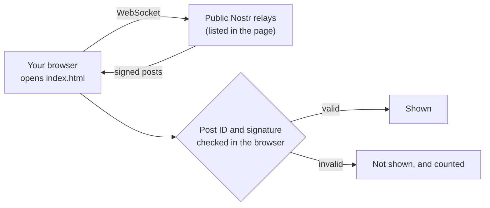

<div align="center">

# 📡 Starhold status reader

**A backup way to read Starhold's status updates, for when the status site itself is down.**

[](https://starholdsoftware.github.io/status-reader/)
[](https://status.starhold.app)


[What it is](#what) · [How it checks](#how) · [Privacy](#privacy) · [Another feed](#other) · [Contact](#contact)

</div>

<a id="what"></a>
## 🛟 What it is

Starhold's status updates normally live at **https://status.starhold.app**. Each update is also published as a signed post on public Nostr relays. This page reads those posts straight from the relays, so you can still see what is going on if the status site is unreachable.

> [!NOTE]
> This is a fallback display only. The status site is the main place for Starhold's status.

Open **https://starholdsoftware.github.io/status-reader/** and it shows Starhold's own status feed.

<a id="how"></a>
## 🔏 How it checks what it shows



- Every post's ID (SHA-256) and signature (BIP-340) is checked in your browser before it is shown. A post that fails the check is not shown, and the page says how many failed.
- Only posts signed by the feed's key are accepted.
- The page also lists which relays answered.

<a id="privacy"></a>
## 🔒 Privacy

- The page loads no scripts, fonts, images or analytics from anywhere. Everything it needs is inside `index.html`.
- The only connections it makes are to the Nostr relays it reads from. Its Content-Security-Policy allows nothing else.
- It stores nothing: no cookies and no local storage.

<a id="other"></a>
## 🔑 Reading another feed

Put a feed's public key (`npub1...`) after a `#` in the address:

```text
https://starholdsoftware.github.io/status-reader/#npub1...
```

You can also type the key into the box on the page. Several keys can be given, separated by commas.

<a id="contact"></a>
## ✉️ Contact

hello@starhold.dev

<details>
<summary>Files in this repository</summary>

| File | What it is |
|---|---|
| `index.html` | The reader. One self-contained page. |
| `THIRD-PARTY-NOTICES.md` | The signature library it contains (`@noble/secp256k1` 3.2.0, MIT). |
| `.nojekyll` | Tells GitHub Pages to serve the files as they are. |

</details>

---

<sub>© Starhold. Licence to be announced. The included signature library is MIT-licensed: see THIRD-PARTY-NOTICES.md.</sub>
